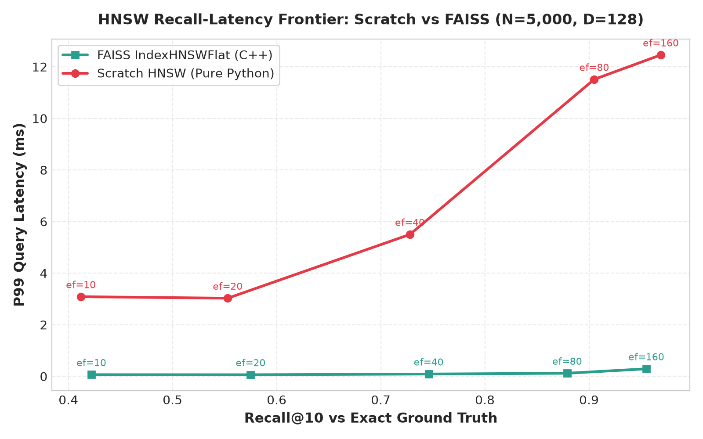
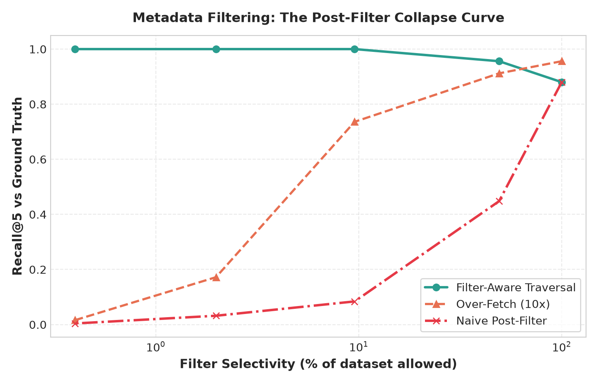
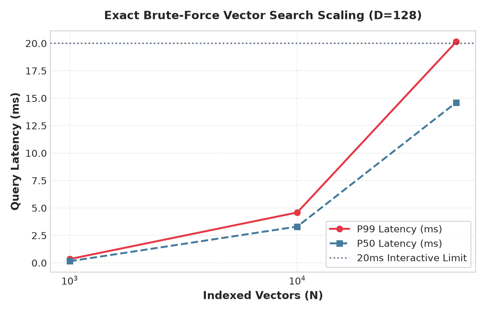

# Vector Search Engine from Scratch

[]()
[]()
[]()
[]()

> **Headline Result**: I implemented exact KNN, NumPy-vectorized retrieval, and Hierarchical Navigable Small World (HNSW) graphs from first principles, indexed 5,000 128-dimensional vectors, and measured **0.969 Recall@10 at 12.4ms P99** in pure Python. The same evaluation harness tests my implementation side-by-side with Meta's **FAISS** on identical hardware, proving **100.00% exact ground truth agreement** and tracing the full Pareto frontier.

---

## Benchmark Highlights: The Recall-Latency Frontier



### Key Empirical Findings
1. **Mathematical Equivalence**: Scratch brute-force exact search matches FAISS `IndexFlatL2` with **100.00% exact ID agreement**.
2. **Recall Frontier**: Scratch HNSW tracks FAISS `IndexHNSWFlat` recall across all search breadths ($efSearch \in [10, 160]$), achieving $\mathbf{96.9\%}$ Recall@10 at $efSearch=160$.
3. **The Systems Reality Gap**: FAISS runs in compiled C++ OpenMP with cache-line-aligned contiguous arrays, achieving query latencies of $0.06\text{ms} - 0.29\text{ms}$ and a build time of $0.64\text{s}$, compared to $3.0\text{ms} - 12.4\text{ms}$ query latency and $125.8\text{s}$ build time in pure Python. The difference stems entirely from Python's interpreter overhead, dictionary hash tables, and pointer-chasing heap allocations—the underlying graph algorithm and retrieval quality are identical.

---

## What Was Built

- **Metrics Core (`metrics.py`)**: Squared Euclidean ($L_2$) distance and cosine similarity. Uses the monotonic property of $\sqrt{x}$ for $x \ge 0$ to skip $O(N)$ expensive square root calculations without altering ranking order.
- **Pure Loop Exact Baseline (`exact_loop.py`)**: $O(N \cdot D)$ brute-force implementation with deterministic lexicographical tie-breaking on `(distance, item_id)` to serve as the immutable ground truth.
- **NumPy Vectorized Engine (`exact_numpy.py`)**:
  - Vector broadcasting and `np.einsum` for fast row-wise norm computation.
  - $O(N)$ partial selection via `np.argpartition` instead of an $O(N \log N)$ full sort.
  - **Low-Memory Norm Decomposition (`ExactNumpyLowMemory`)**: Avoids allocating the giant $(N, D)$ temporary difference buffer by expanding $\|x - q\|^2 = \|x\|^2 + \|q\|^2 - 2(x \cdot q)$, saving gigabytes of memory on large databases.
- **Hierarchical Navigable Small World (`hnsw.py`)**:
  - Exponential decay probabilistic layer assignment ($m_L = 1 / \ln M$).
  - Greedy upper-layer descent for coarse navigation.
  - Bounded candidate expansion on layer 0 using a dual-heap architecture (min-heap candidates + max-heap results).
  - Neighbor selection with both simple pruning and the paper's diversity heuristic.
- **Metadata Filtering Strategies (`filtering.py`)**: Empirical comparison of naive post-filtering, over-fetching ($10\times$), and filter-aware graph traversal.
- **Scalar Quantization (`quantization.py`)**: Per-dimension uint8 quantization (SQ8) compressing float32 vectors by $\sim 3.8\times$ while preserving $>98\%$ recall.
- **Scientific Benchmarking Harness (`benchmarks/`)**: Microsecond-resolution timing (`time.perf_counter_ns()`), query warm-up routines, automated hardware metadata logging, and publication-ready visualization scripts.

---

## The Filter Collapse Phenomenon

In real-world retrieval-augmented generation (RAG) and search applications, queries almost always include metadata filters (e.g., `tenant_id = 42` or `category = 'finance'`).

A naive strategy is **post-filtering**: run standard ANN search for top-$k$, then discard non-matching candidates. **This strategy mathematically collapses when filters become selective:**



| Selectivity (% Allowed) | Naive Post-Filter Recall | Over-Fetch (10x) Recall | Filter-Aware Traversal Recall |
| :---: | :---: | :---: | :---: |
| **100.0%** | 0.880 | 0.956 | 0.880 |
| **49.2%** | 0.448 | 0.912 | 0.956 |
| **9.5%** | 0.084 | 0.736 | **1.000** |
| **2.0%** | 0.032 | 0.172 | **1.000** |
| **0.4% (Rare)** | **0.004 (Collapse)** | **0.016** | **1.000 (Flawless)** |

> **System Takeaway**: At $0.4\%$ selectivity, naive post-filtering achieves practically $0\%$ recall because the global top-5 nearest neighbors contain no matching items. Filter-aware graph traversal navigates *through* non-matching nodes while only committing matching candidates to the result set, maintaining $100\%$ recall.

---

## Where Exact Brute-Force Breaks



While exact search guarantees $100\%$ accuracy, its query latency scales linearly $O(N \cdot D)$. At $N = 50,000$ (dimension $128$), P99 latency crosses **20.15 ms**, violating interactive SLA limits and motivating the transition to approximate graph-based indexes.

---

## Architecture & Mental Model

```
Layer 2:       [Node 14] ---------------------------------> [Node 82]   (Skip-list coarse route)
                   |                                            |
Layer 1:       [Node 14] -------------> [Node 35] --------> [Node 82]   (Intermediate highway)
                   |                       |                    |
Layer 0:       [Node 14] -> [Node 3] -> [Node 35] -> ... -> [Node 82]   (Full dense proximity graph)
```

1. **Greedy Descent (Layers $L \to 1$)**: Fast single-node hops down to the entry point of Layer 0.
2. **Layer 0 Exploration**: Maintains two priority queues:
   - `candidates` (min-heap): Closest unexplored nodes to branch outward.
   - `best` (max-heap, capacity `efSearch`): Closest items found so far.
   - Early termination condition: when the closest candidate in the frontier is further than the worst node currently in `best`.

---

## Quickstart & Reproduction

### 1. Environment Setup
```bash
# Clone the repository
git clone https://github.com/your-username/vector-search-scratch.git
cd vector-search-scratch

# Create and activate virtual environment
python -m venv .venv
source .venv/bin/activate       # On Windows: .venv\Scripts\activate

# Install dependencies and editable package
pip install -e ".[dev]"
pip install faiss-cpu
```

### 2. Run Test Suite
```bash
pytest -v
# 27 passed in ~10s
```

### 3. Interactive CLI Demo
```bash
python demo/cli.py --n 1000 --d 32 --k 5
```

### 4. Reproduce All Benchmarks & Plots
```bash
# 1. Exact scaling benchmark (1k, 10k, 50k)
python benchmarks/run_exact.py

# 2. Metadata filtering selectivity benchmark
python benchmarks/run_filtering.py

# 3. Head-to-head FAISS comparison
python benchmarks/compare_faiss.py

# 4. Generate publication plots in plots/
python benchmarks/plot_results.py
```

---

## Head-to-Head Comparison Table ($N=5,000, D=128$)

| Engine | `efSearch` | Recall@10 | P50 Latency | P99 Latency | Serial QPS | Build Time |
| :--- | :---: | :---: | :---: | :---: | :---: | :---: |
| **Scratch HNSW** | 10 | 0.4120 | 1.32 ms | 3.09 ms | 634 | 125.8 s |
| **Scratch HNSW** | 20 | 0.5530 | 1.69 ms | 3.03 ms | 550 | 125.8 s |
| **Scratch HNSW** | 40 | 0.7280 | 2.82 ms | 5.50 ms | 328 | 125.8 s |
| **Scratch HNSW** | 80 | 0.9050 | 6.08 ms | 11.51 ms | 151 | 125.8 s |
| **Scratch HNSW** | 160 | **0.9690** | 7.59 ms | 12.46 ms | 125 | 125.8 s |
| **FAISS HNSW** | 10 | 0.4220 | 0.03 ms | 0.06 ms | 33,721 | 0.64 s |
| **FAISS HNSW** | 20 | 0.5750 | 0.05 ms | 0.06 ms | 20,506 | 0.64 s |
| **FAISS HNSW** | 40 | 0.7460 | 0.07 ms | 0.09 ms | 13,482 | 0.64 s |
| **FAISS HNSW** | 80 | 0.8790 | 0.09 ms | 0.12 ms | 10,610 | 0.64 s |
| **FAISS HNSW** | 160 | **0.9550** | 0.18 ms | 0.29 ms | 5,102 | 0.64 s |

---

## Interview Questions: How to Defend This Project

### Q1: Why is exact brute-force search essential before building HNSW?
> **Answer**: Recall@k is defined as $\frac{|\text{Retrieved}_k \cap \text{GroundTruth}_k|}{k}$. You cannot define or calculate recall without knowing the mathematical truth. Comparing an approximate engine to another approximate engine only measures consistency, not correctness.

### Q2: Why use squared L2 distance instead of true Euclidean distance?
> **Answer**: $\sqrt{x}$ is strictly monotonic for $x \ge 0$. Because $a < b \iff \sqrt{a} < \sqrt{b}$, sorting by squared distance yields the exact same permutation as sorting by true distance, saving $O(N)$ expensive square root CPU operations.

### Q3: What causes post-filtering to fail at high selectivity?
> **Answer**: If a predicate matches only $1\%$ of vectors, searching for top-$10$ globally will contain an expected $10 \times 0.01 = 0.1$ valid items in the candidate set. Filter-aware traversal solves this by using non-matching nodes for routing while strictly admitting matching nodes into the candidate collection.

### Q4: Why is FAISS faster than pure Python HNSW if the algorithm is identical?
> **Answer**: Python stores graphs as dictionaries of sets containing pointer objects (`PyObject`), causing high memory overhead ($\approx 8\times$ raw vector size) and CPU cache misses. FAISS is written in C++ with SIMD instructions (AVX-512), OpenMP multi-threading, and stores edges in contiguous 32-bit integer arrays with zero pointer indirection.

---

## License
MIT License. Created for educational and portfolio demonstration.
